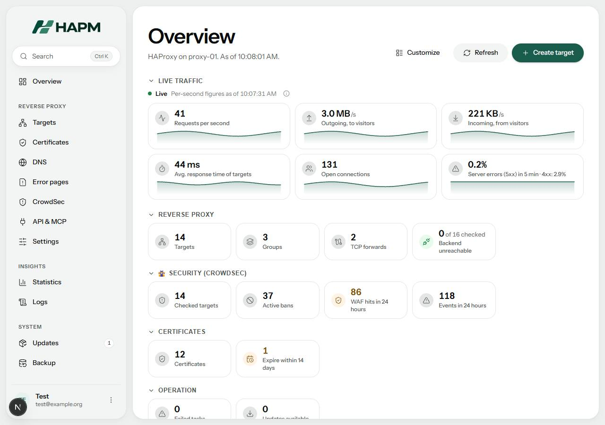
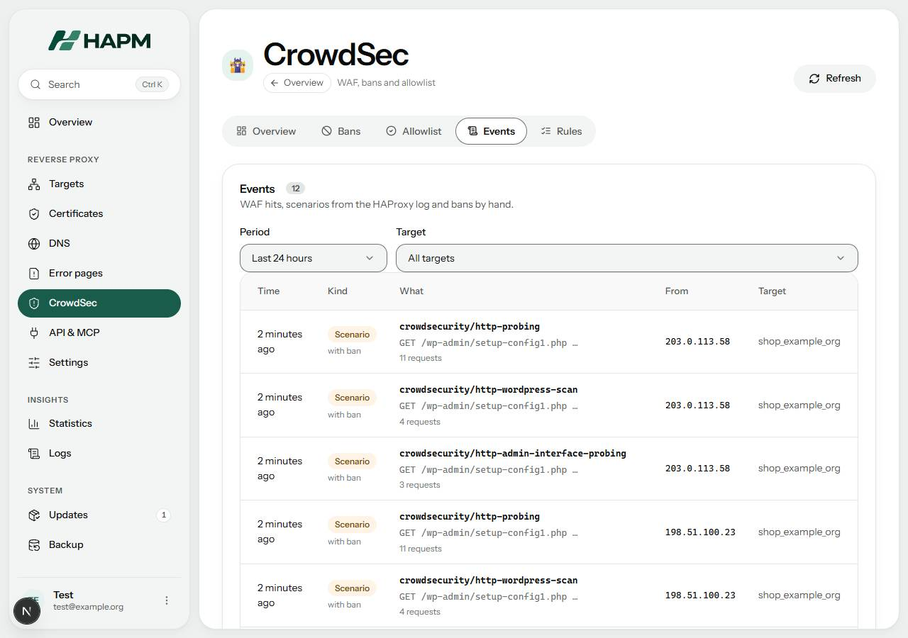
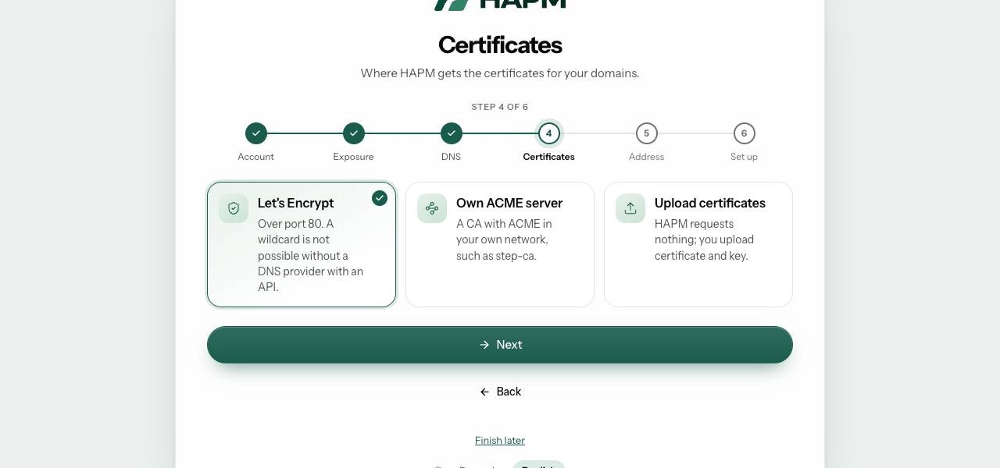
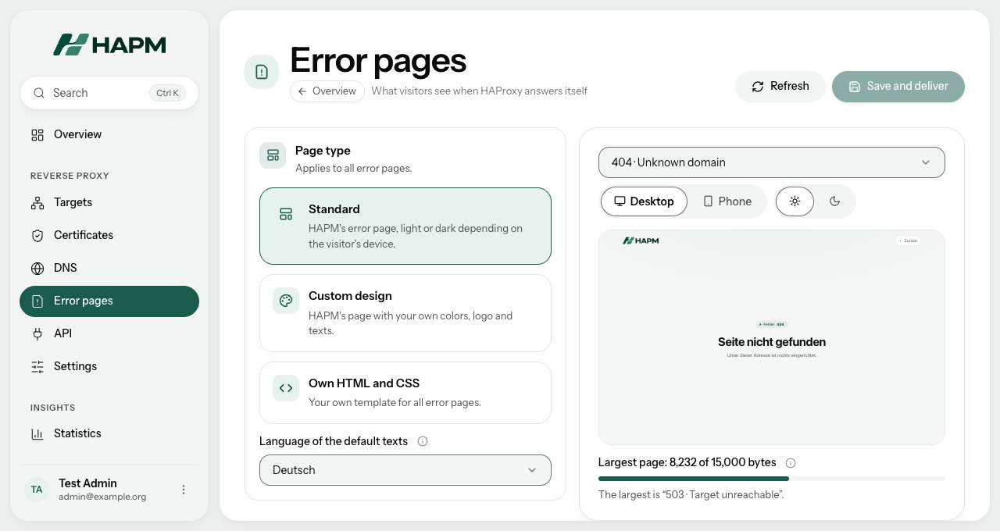
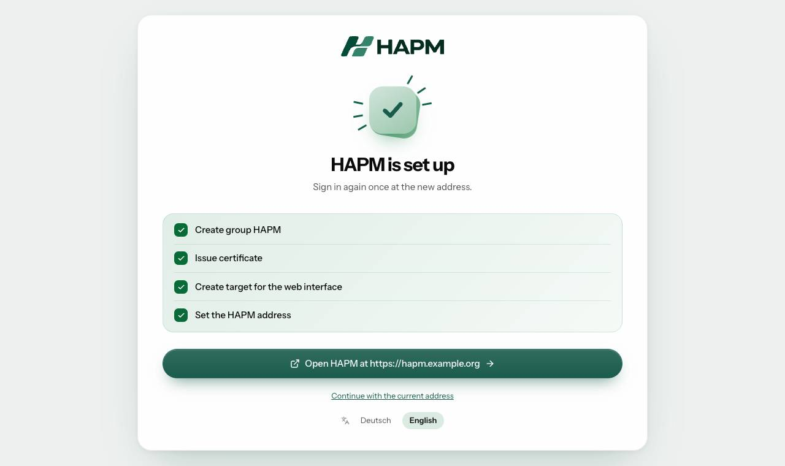
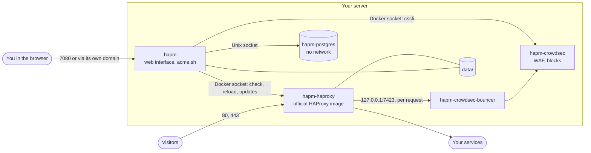

<div align="center">

<picture>
  <source media="(prefers-color-scheme: dark)" srcset="public/hapm-logo-white.svg">
  
</picture>

### HAProxy with a web interface. One server, one command, done.

Create domains, certificates and redirects in your browser.<br>
HAPM sets up HAProxy, Let's Encrypt, the base configuration and CrowdSec as a WAF by itself.

[](https://github.com/tjorvenhu/HAPM/actions/workflows/image.yml)
[](LICENSE)
[](https://github.com/tjorvenhu/HAPM/pkgs/container/hapm)


[Deutsch](README.md) · **English**

</div>

---

<p align="center">
  
  
</p>
<p align="center">
  
  
</p>

## Contents

- [What is HAPM?](#what-is-hapm)
- [Features](#features)
- [Quick start](#quick-start)
- [Installation](#installation)
  - [Requirements](#requirements)
  - [Memory and disk space](#memory-and-disk-space)
  - [Option 1: Docker Compose only](#option-1-docker-compose-only)
  - [Option 2: Install script](#option-2-install-script)
  - [Option 3: Portainer, Dockge and other UIs](#option-3-portainer-dockge-and-other-uis)
  - [Corporate networks: firewall and proxy](#corporate-networks-firewall-and-proxy)
- [First steps](#first-steps)
- [Configuration](#configuration)
- [CrowdSec (WAF)](#crowdsec-waf)
- [Control with Claude (MCP)](#control-with-claude-mcp)
- [Architecture](#architecture)
- [Operations](#operations)
- [Security](#security)
- [Troubleshooting](#troubleshooting)
- [Documentation](#documentation)
- [Contributing](#contributing)
- [License](#license)

## What is HAPM?

HAPM is a web interface for [HAProxy](https://www.haproxy.org). It runs as a
small Docker stack on the server that should be your reverse proxy. In the
browser you decide which domain points where. HAPM writes the configuration,
has HAProxy check it, reloads and fetches the certificates.

- **No configuration knowledge required.** A wizard guides you through the
  setup. At the end, HAPM itself is reachable over HTTPS.
- **`haproxy.cfg` stays the source of truth.** HAPM reads the file on every
  request and only writes between its own markers. Anything you add by hand
  next to them stays untouched.
- **Safe changes.** HAProxy checks every change before it takes effect. If
  HAProxy rejects it, the previous configuration stays active.

> [!NOTE]
> The web interface is available in German and English. You can switch the
> language on the login page and per account.

## Features

<table>
<tr>
<td width="50%" valign="top">

**Reverse proxy**
- Domains to a target on your network, with certificate
- Load balancing across several targets, with weights and sticky sessions
- HTTP redirects (301, 302)
- TCP forwarding for any port, for example databases
- Path rules: one path of the same domain to another port
- Groups, for example "Websites" and "Internal"
- Store backend servers once and pick them in every target
- Import an existing `haproxy.cfg` with a preview

</td>
<td width="50%" valign="top">

**Certificates and DNS**
- Let's Encrypt via acme.sh, renewed automatically
- Wildcard certificates via DNS-01
- Connect zones at Cloudflare and Hetzner
- Your own name server over RFC 2136 (BIND with a TSIG key)
- Infoblox through the WAPI (not yet tried against a real appliance)
- Create the DNS record for a target in the same step
- See in the dialog where a domain currently points
- Servers on a private network only: every certificate via DNS-01
- Your own ACME server, for example step-ca on your network
- Upload certificates if HAPM should not request any
- Your own DNS server: HAPM tells you the records instead of creating them

</td>
</tr>
<tr>
<td valign="top">

**Protection and appearance**
- WAF with CrowdSec: for all targets or single ones, attacks are rejected with 403
- Ban and allow addresses, events per target, OWASP rules if you want them
- Block addresses, countries and too many requests (access protection)
- Allow domains only for specific IP addresses
- Password prompt in front of a domain, served by HAProxy itself
- Error pages: standard, custom design, or your own HTML file
- Accounts with password, second factor and passkeys

</td>
<td valign="top">

**Operations**
- Overview in sections you can reorder, collapse and hide
- Statistics: requests, status codes, response times, countries, plus CrowdSec
- History of every operation with its steps
- The HAProxy and CrowdSec logs in your browser, with search and filters
- One-click updates for HAPM, HAProxy, acme.sh and CrowdSec
- Daily backups and restore from the web interface
- Email alerts on outages, expiring certificates and errors
- API with tokens for scripts and other services
- MCP server: control HAPM from Claude and other AI clients
- Web interface in German and English
- Your own logo, name and accent color to present HAPM as your own tool

</td>
</tr>
</table>

## Quick start

On a Linux server with Docker, as root:

```bash
mkdir -p /opt/hapm && cd /opt/hapm
curl -fsSLO https://raw.githubusercontent.com/tjorvenhu/HAPM/main/docker-compose.yml
docker compose up -d
```

Then open `http://<server-ip>:7080` in your browser. The wizard takes care of
the rest.

> [!TIP]
> No Docker yet? Use the [install script](#option-2-install-script). It
> installs Docker as well.

## Installation

### Requirements

| What | Why |
|---|---|
| A **Linux** server, `amd64` or `arm64` | HAPM and HAProxy use the host network. That only works on Linux, not with Docker Desktop on Mac or Windows |
| **Docker** with the **Compose plugin** (Compose v2) | `docker compose version` shows whether it is installed. 2.20 or newer is recommended |
| Ports **80** and **443** free | HAProxy listens there. For HTTP/3, also 443 over UDP |
| Port **7080** reachable | For the setup. You can close it afterwards, see [Security](#security) |
| For Let's Encrypt certificates: port 80 reachable from the internet | Let's Encrypt validates every domain over port 80. On a private network, certificates use DNS-01 instead |
| Outbound HTTPS (TCP 443) | For images, certificates, updates and the CrowdSec rules. The exact hosts: [Corporate networks](#corporate-networks-firewall-and-proxy) |
| **1 GB** of memory without CrowdSec, **2 GB** with | The stack itself needs about 250 MB without and about 390 MB with CrowdSec, see [Memory and disk space](#memory-and-disk-space) |

### Memory and disk space

Measured with `docker stats` on an idle test installation (amd64, November
2026). The figures are guidance, not a promise: they depend on the number of
connections and on traffic.

| Container | Memory | Without CrowdSec | With CrowdSec |
|---|---|:---:|:---:|
| HAPM (web interface, scheduler) | about 120 MB | yes | yes |
| HAProxy | about 95 MB | yes | yes |
| Postgres | about 35 MB | yes | yes |
| CrowdSec (detection, WAF) | 100 to 130 MB | | yes |
| CrowdSec bouncer | about 10 MB | | yes |
| **Total** | | **about 250 MB** | **about 390 MB** |

- **Without CrowdSec** (`--no-crowdsec` at install time): about 250 MB. A
  server with 1 GB is enough, operating system and Docker included.
- **With CrowdSec** (the default): about 390 MB, roughly 140 MB more. A server
  with 2 GB is the comfortable size. Both containers run and hold their memory
  even while CrowdSec checks no target yet. Switched off in the web interface
  ("Switch off CrowdSec") they are stopped and use nothing.
- **What raises the need:** many concurrent connections (HAProxy), heavy
  traffic and the community blocklist (CrowdSec), the OWASP rules in "Report
  only" or "Block hits" mode. During an update or a backup a helper container
  runs briefly.
- **Measure it yourself:** `docker stats --no-stream` shows the usage of every
  container.

On disk the images take about 1.1 GB without and about 1.7 GB with CrowdSec.
On top comes the data in `data/` (database, certificates, logs, CrowdSec
rules): about 100 MB freshly installed, growing with logs and statistics.
Before an update the new image briefly sits next to the old one.

### Option 1: Docker Compose only

No script, exactly one file. These steps work on any Linux with Docker.

**1. Install Docker** if it is missing. The guide for your distribution is at
[docs.docker.com/engine/install](https://docs.docker.com/engine/install/).
On Debian and Ubuntu, Docker's official script works too:

```bash
curl -fsSL https://get.docker.com | sh
```

**2. Create a folder for HAPM** and change into it:

```bash
mkdir -p /opt/hapm && cd /opt/hapm
```

**3. Download `docker-compose.yml`:**

```bash
curl -fsSLO https://raw.githubusercontent.com/tjorvenhu/HAPM/main/docker-compose.yml
```

<details>
<summary><b>Without downloading:</b> the file to paste</summary>

Create the file with `nano docker-compose.yml` and paste this. The full
version with comments is [`docker-compose.yml`](docker-compose.yml).

```yaml
name: hapm

services:
  hapm:
    image: ${HAPM_IMAGE:-ghcr.io/tjorvenhu/hapm:latest}
    container_name: hapm
    restart: unless-stopped
    network_mode: host
    environment:
      PORT: ${HAPM_PORT:-7080}
      HOSTNAME: ${HAPM_BIND:-0.0.0.0}
      TZ: ${TZ:-Europe/Berlin}
      HAPM_ACME_SERVER: ${HAPM_ACME_SERVER:-letsencrypt}
      HAPM_CROWDSEC_OFF: ${HAPM_CROWDSEC_OFF:-}
      HAPM_SPOA_PORT: ${HAPM_SPOA_PORT:-7423}
    depends_on:
      postgres:
        condition: service_healthy
    volumes:
      - ${HAPM_STORAGE:-./data}/hapm:/data
      - ${HAPM_STORAGE:-./data}/haproxy:/etc/haproxy
      - ${HAPM_STORAGE:-./data}/run/haproxy:/run/haproxy
      - ${HAPM_STORAGE:-./data}/log:/var/log/haproxy
      - ${HAPM_STORAGE:-./data}/acme:/root/.acme.sh
      - ${HAPM_STORAGE:-./data}/crowdsec:/crowdsec
      - ${HAPM_STORAGE:-./data}/run/postgres:/var/run/postgresql
      - /var/run/docker.sock:/var/run/docker.sock

  postgres:
    image: postgres:17-alpine
    container_name: hapm-postgres
    restart: unless-stopped
    network_mode: none
    command: >-
      postgres -c listen_addresses='' -c shared_buffers=32MB -c max_connections=20
      -c max_worker_processes=4 -c max_parallel_workers=0 -c autovacuum_max_workers=1 -c jit=off
    environment:
      POSTGRES_DB: hapm
      POSTGRES_USER: hapm
      POSTGRES_HOST_AUTH_METHOD: trust
    volumes:
      - ${HAPM_STORAGE:-./data}/postgres:/var/lib/postgresql/data
      - ${HAPM_STORAGE:-./data}/run/postgres:/var/run/postgresql
    healthcheck:
      test: ["CMD-SHELL", "pg_isready -U hapm -d hapm"]
      interval: 5s
      timeout: 5s
      retries: 12
      start_period: 20s

  haproxy:
    image: ${HAPROXY_IMAGE:-haproxy:lts}
    container_name: hapm-haproxy
    restart: unless-stopped
    network_mode: host
    user: root
    command: ["haproxy", "-f", "/etc/haproxy/haproxy.cfg", "-S", "/run/haproxy/master.sock"]
    depends_on:
      hapm:
        condition: service_healthy
    volumes:
      - ${HAPM_STORAGE:-./data}/haproxy:/etc/haproxy:ro
      - ${HAPM_STORAGE:-./data}/run/haproxy:/run/haproxy
    ulimits:
      nofile:
        soft: 65536
        hard: 65536
    logging:
      driver: json-file
      options:
        max-size: "50m"
        max-file: "3"

  crowdsec:
    image: ${CROWDSEC_IMAGE:-crowdsecurity/crowdsec:latest}
    container_name: hapm-crowdsec
    restart: unless-stopped
    profiles: ["${HAPM_CROWDSEC_OFF:+ohne-crowdsec}"]
    environment:
      TZ: ${TZ:-Europe/Berlin}
      COLLECTIONS: crowdsecurity/haproxy crowdsecurity/appsec-virtual-patching crowdsecurity/appsec-generic-rules
    depends_on:
      hapm:
        condition: service_healthy
    volumes:
      - ${HAPM_STORAGE:-./data}/crowdsec/config:/etc/crowdsec
      - ${HAPM_STORAGE:-./data}/crowdsec/data:/var/lib/crowdsec/data
      - ${HAPM_STORAGE:-./data}/crowdsec/secrets:/run/secrets:ro
      - ${HAPM_STORAGE:-./data}/log:/var/log/haproxy:ro
    logging:
      driver: json-file
      options:
        max-size: "20m"
        max-file: "3"

  crowdsec-bouncer:
    image: ${CROWDSEC_BOUNCER_IMAGE:-crowdsecurity/spoa-bouncer:latest}
    container_name: hapm-crowdsec-bouncer
    restart: unless-stopped
    profiles: ["${HAPM_CROWDSEC_OFF:+ohne-crowdsec}"]
    depends_on:
      - crowdsec
    ports:
      - "127.0.0.1:${HAPM_SPOA_PORT:-7423}:7423"
    volumes:
      - ${HAPM_STORAGE:-./data}/crowdsec/bouncer:/etc/crowdsec/bouncers:ro
    logging:
      driver: json-file
      options:
        max-size: "20m"
        max-file: "3"
```

</details>

**4. Optional: settings in `.env`.** Without this file, the defaults apply.
For example, a different port for the web interface:

```bash
echo "HAPM_PORT=9000" > .env
```

All values are listed under [Configuration](#configuration).

**5. Start:**

```bash
docker compose up -d
```

On the first start, Docker pulls five images and HAPM sets up HAProxy. This
takes about a minute. To check that everything runs:

```bash
docker compose ps
```

All containers should show `running`, and `hapm` also `healthy`. That is five
containers, three without CrowdSec.

**6. Open it in your browser:** `http://<server-ip>:7080`. Continue with
[First steps](#first-steps).

> [!NOTE]
> All data then lives in `/opt/hapm/data`: configuration, certificates and
> database. Back up this folder and you have everything.

### Option 2: Install script

For a fresh Debian or Ubuntu server. The script installs Docker if it is
missing, checks ports 80 and 443, downloads `docker-compose.yml` and starts
HAPM. As root:

```bash
curl -fsSL https://raw.githubusercontent.com/tjorvenhu/HAPM/main/install.sh | sh
```

At the end it prints the address of the web interface. Running it again
updates HAPM without touching data or settings.

<details>
<summary><b>Script options</b></summary>

| Option | Variable | Default | Meaning |
|---|---|---|---|
| `--dir DIR` | `HAPM_DIR` | `/opt/hapm` | Installation folder |
| `--storage DIR` | `HAPM_STORAGE` | `<dir>/data` | Data folder, for example on a separate disk |
| `--port PORT` | `HAPM_PORT` | `7080` | Port of the web interface |
| `--image IMAGE` | `HAPM_IMAGE` | `ghcr.io/tjorvenhu/hapm:latest` | A different HAPM image |
| `--force` | `HAPM_FORCE=1` | | Start even if port 80 or 443 is in use |
| `--yes` | `HAPM_YES=1` | | Do not ask, use the defaults |
| `--no-crowdsec` | `HAPM_CROWDSEC=0` | | Install without CrowdSec: no images, no containers, see [CrowdSec (WAF)](#crowdsec-waf) |
| `--crowdsec` | | | Add CrowdSec back to the stack |
| `--uninstall` | | | Remove HAPM again, see [Uninstall](#uninstall) |

Example with options:

```bash
curl -fsSL https://raw.githubusercontent.com/tjorvenhu/HAPM/main/install.sh | sh -s -- --dir /srv/hapm --port 9000
```

The first installation decides where the data lives. Running the script again
does not change that.

</details>

### Option 3: Portainer, Dockge and other UIs

HAPM is a regular Compose stack. Create a new stack in your UI and paste the
contents of [`docker-compose.yml`](docker-compose.yml).

> [!IMPORTANT]
> Set the variable `HAPM_STORAGE` to a fixed path, for example
> `/opt/hapm/data`. Without it, the UI stores the data relative to its own
> working folder, where it is hard to find and to back up.

### Corporate networks: firewall and proxy

If the firewall only lets approved outbound traffic through, the server mainly
needs HTTPS (TCP 443) to these hosts:

- **Images:** `ghcr.io`, `pkg-containers.githubusercontent.com`,
  `registry-1.docker.io`, `auth.docker.io`, `production.cloudfront.docker.com`,
  `production.cloudflare.docker.com`
- **Certificates:** `acme-v02.api.letsencrypt.org`, with DNS-01 also
  `cloudflare-dns.com` and the API of the DNS provider (`api.cloudflare.com` or
  `api.hetzner.cloud`). With your own name server (RFC 2136) port 53 (TCP and
  UDP) to it instead, with Infoblox port 443 to the appliance
- **Updates and countries:** `api.github.com`, `github.com`,
  `codeload.github.com`, `download.db-ip.com`
- **CrowdSec:** `cdn-hub.crowdsec.net`, `hub-data.crowdsec.net`, and for the
  community blocklist `api.crowdsec.net` and `blocklists.api.crowdsec.net`

Plus DNS (53), NTP (123 UDP) and, if mail is set up, the SMTP server (587 or
465). Allow hosts by name, not by IP address: they sit behind CDNs with
changing addresses.

Behind a proxy, the Docker engine needs it for the images, and the `hapm` and
`crowdsec` containers need it for their own requests. HAPM only honors
`HTTPS_PROXY` together with `NODE_USE_ENV_PROXY=1`. The full list with the
purpose of each host and the proxy setup is in
[`docs/betrieb.md`](docs/betrieb.md#ausgehende-verbindungen-firmennetz-firewall-proxy)
(German).

## First steps

After the start, `http://<server-ip>:7080` opens the wizard. It has seven steps:

| Step | What happens |
|---|---|
| **1. Account** | You create the first account to manage HAPM |
| **2. Reachability** | Reachable from the internet or only on your private network? This decides how certificates are issued |
| **3. DNS** | Cloudflare or Hetzner with an API token, your own name server with a TSIG key (RFC 2136) or Infoblox: then HAPM creates DNS records itself. Or **your own DNS server**: HAPM tells you every record to set yourself |
| **4. Certificates** | **Let's Encrypt** (default), **your own ACME server** with a directory URL, for example step-ca on your network, or **upload**: HAPM requests nothing, you upload certificate and key |
| **5. Email** | The SMTP account HAPM sends email through: for passkeys, "Forgot password" and notifications. Can be skipped and set up later under "Notifications" |
| **6. Web interface address** | The domain for HAPM itself, for example `hapm.example.org`. HAPM shows the required DNS record and creates it at the provider if one is connected |
| **7. Set up** | HAPM issues the certificate and adds itself as a target. Afterwards the web interface is reachable over HTTPS |

<p align="center">
  
</p>

When you then open HAPM at its own address for the first time, a dialog offers to set up a passkey or a second factor. Only there, because your password manager then saves the sign-in for the right address.

If a step fails, the account stays. You can change your input and try again,
or continue later: the overview reminds you.

**Afterwards:** add more domains under "Targets". Every target belongs to a
group. If you skipped the wizard, create a group there first.

> [!TIP]
> To try things out without using your Let's Encrypt rate limits, set
> `HAPM_ACME_SERVER=letsencrypt_test` in `.env`. The certificates are not
> trusted then, but every step can be tested.

## Configuration

All settings in `.env` next to `docker-compose.yml` are optional. A template
with explanations is in [`.env.example`](.env.example) (comments in German).
After a change: `docker compose up -d`.

| Variable | Default | Meaning |
|---|---|---|
| `HAPM_PORT` | `7080` | Port of the web interface |
| `HAPM_BIND` | `0.0.0.0` | Address the web interface listens on. With `127.0.0.1` it is only reachable through its domain |
| `HAPM_STORAGE` | `./data` | Folder for all data on the server |
| `TZ` | `Europe/Berlin` | Time zone for display and scheduled updates |
| `HAPM_ACME_SERVER` | `letsencrypt` | Default certificate authority: `letsencrypt`, `letsencrypt_test`, `zerossl` or the URL of an ACME directory. An ACME server set under "General" takes precedence |
| `HAPROXY_IMAGE` | `haproxy:lts` | HAProxy image. `haproxy:latest` follows the newest branch |
| `HAPM_IMAGE` | `ghcr.io/tjorvenhu/hapm:latest` | HAPM image |
| `HAPM_CROWDSEC_OFF` | empty | `1`: CrowdSec is not part of the stack, Compose neither pulls its images nor creates containers. See [CrowdSec (WAF)](#crowdsec-waf) |
| `HAPM_SPOA_PORT` | `7423` | Port on which HAProxy reaches the CrowdSec bouncer. Only on `127.0.0.1` |

Everything else is configured in the web interface, under "General" and
"Reverse proxy, Settings".

## CrowdSec (WAF)

 HAPM ships with [CrowdSec](https://www.crowdsec.net). It checks requests
before HAProxy passes them to a target and rejects attacks with 403: known
vulnerabilities, suspicious paths such as `/.env`, and optionally the OWASP
rules. From the HAProxy log it detects addresses that probe your sites and
blocks them.

**After installation, CrowdSec checks nothing.** The containers run, but
requests only go to CrowdSec once you switch it on in the web interface: under
"Reverse proxy, CrowdSec" for all targets, or with the "CrowdSec (WAF)" switch
in the dialog of a target. If you choose "Reachable from the internet" in the
setup wizard, it suggests switching it on for all targets.

The web interface shows blocks, events per target and statistics. You can block
or allow addresses by hand and add rule sets, for example for WordPress.

**Requirements:**

| What | Why |
|---|---|
| The images `crowdsecurity/crowdsec` and `crowdsecurity/spoa-bouncer` | Docker pulls them on the first start |
| Outbound HTTPS to the CrowdSec hub | The rules come from `cdn-hub.crowdsec.net` and `hub-data.crowdsec.net`, see [Corporate networks](#corporate-networks-firewall-and-proxy) |
| Port `127.0.0.1:7423` free | HAProxy reaches the bouncer there. A different port: `HAPM_SPOA_PORT` |
| Roughly 100 MB of additional memory | Measured at idle: CrowdSec about 75 MB, the bouncer about 10 MB. More with the OWASP rules |
| HAProxy 2.4 or newer | The `haproxy:lts` image meets this |

> [!NOTE]
> By default, CrowdSec reports the addresses it blocks to the CrowdSec Central
> API (`api.crowdsec.net`) and receives the community blocklist in return. That
> is how CrowdSec itself behaves. How to turn it off is described in
> [`docs/crowdsec.md`](docs/crowdsec.md) (German).

### Adding CrowdSec later

If you installed HAPM before CrowdSec, your `docker-compose.yml` lacks the two
containers. The web interface then hides CrowdSec. To add it:

```bash
sh /opt/hapm/install.sh
```

The script fetches the new `docker-compose.yml`, keeps `.env` and all data as
they are, and restarts the containers, now with CrowdSec. Without the script,
with option 1:

```bash
cd /opt/hapm
curl -fsSLO https://raw.githubusercontent.com/tjorvenhu/HAPM/main/docker-compose.yml
docker compose pull && docker compose up -d
```

Afterwards CrowdSec is under "Reverse proxy, CrowdSec" and checks nothing until
you switch it on. With Portainer or Dockge (option 3): paste the content of the
new `docker-compose.yml` into the stack and redeploy.

**Install without CrowdSec:**

```bash
curl -fsSL https://raw.githubusercontent.com/tjorvenhu/HAPM/main/install.sh | sh -s -- --no-crowdsec
```

The script writes `HAPM_CROWDSEC_OFF=1` to `.env`. Docker Compose then does not
see the two services at all: it neither pulls their images nor starts
containers. With options 1 and 3: `HAPM_CROWDSEC_OFF=1` in `.env` or in the
variables of the stack, before the first start.

**Switch it off in the web interface:** "Switch off CrowdSec" at the top of
the CrowdSec page removes it from every target, stops both containers and hides
CrowdSec everywhere. Bans, allowlist and rules stay stored. Switch it on again
under System, General, tab "CrowdSec".

**Remove it entirely later:** switch it off in the web interface, then

```bash
cd /opt/hapm
echo "HAPM_CROWDSEC_OFF=1" >> .env
docker compose rm -sf crowdsec crowdsec-bouncer
docker compose up -d
```

Or `sh install.sh --no-crowdsec`, which does both. To add it back:
`sh install.sh --crowdsec`, or delete the line from `.env` and run
`docker compose up -d`.
Details on architecture, limits and troubleshooting are in
[`docs/crowdsec.md`](docs/crowdsec.md) (German).

## Control with Claude (MCP)

HAPM ships an MCP server. You can control it from Claude (Claude Code, Claude
Desktop, claude.ai) and other MCP clients: list, create, change and remove
targets, TCP forwards and groups, and read certificates, system status,
statistics and DNS zones.

1. In HAPM, create an API key under **"API & MCP"**. These are the same keys as
   for the API.
2. Connect your client, for Claude Code for example:

   ```bash
   claude mcp add --scope user --transport http hapm https://hapm.example.org/api/mcp \
     --header "Authorization: Bearer hapm_…"
   ```

Ready-made configurations for other clients are on the same page in HAPM, ready
to copy. Details in [`docs/mcp.md`](docs/mcp.md) (German).

> [!WARNING]
> Every tool runs with all permissions of the key and can delete targets. Only
> give a key to clients you trust with that.

> [!NOTE]
> Claude Desktop and claude.ai connect from Anthropic's cloud, so HAPM must be
> reachable over HTTPS from the internet. Claude Code connects from your own
> machine and works on a private network too.

## Architecture

Three containers, two more for CrowdSec, and one folder for the data:



| Container | Role |
|---|---|
| `hapm` | The web interface. Writes `haproxy.cfg`, fetches certificates with acme.sh, collects statistics |
| `hapm-haproxy` | The official HAProxy image. Accepts traffic on ports 80 and 443 |
| `hapm-postgres` | The database: accounts, settings, history. No network, reachable only through a Unix socket |
| `hapm-crowdsec` | CrowdSec: WAF, reads the HAProxy log, keeps blocks and allowlist. Can be switched off |
| `hapm-crowdsec-bouncer` | Takes the questions from HAProxy and passes them to CrowdSec. Not reachable from outside |

<details>
<summary><b>What is inside <code>data/</code></b></summary>

| Subfolder | Contents |
|---|---|
| `hapm/` | Keys and secrets of HAPM. The key in there must never change |
| `haproxy/` | `haproxy.cfg`, certificates, error pages |
| `acme/` | acme.sh with account and renewal entries |
| `postgres/` | The database |
| `log/` | The HAProxy log, source of the statistics |
| `run/` | Sockets of HAProxy and Postgres |
| `crowdsec/` | Configuration, rules and database of CrowdSec, the bouncer settings |

</details>

## Operations

### Updating

In the web interface under **"Updates"**. HAPM reports new images of itself, of
HAProxy and of CrowdSec, and a new acme.sh. A new HAProxy checks the existing configuration
before the switch. If it does not start, the old one keeps running.

**Automatically:** once a day at a fixed time, HAPM installs what you tick
there. The default is everything except HAPM itself (HAProxy, acme.sh, CrowdSec
and the bouncer). HAPM can be added, but is unreachable for about a minute
during the swap.

**An older installation does not get new containers** (such as CrowdSec)
through the Updates page: it only swaps images of existing containers. Run the
install script again instead, see [Adding CrowdSec later](#adding-crowdsec-later).

Manually:

```bash
cd /opt/hapm
docker compose pull && docker compose up -d
```

### Backups

Under **"Backup"**, set a folder on the server. HAPM then backs up daily or on
demand: database, keys, HAProxy with certificates, and acme.sh.

> [!WARNING]
> The archive contains private keys and is not encrypted. Store it only where
> nobody but you has access.

### Restoring

**From the web interface:** under "Backup", card "Restore backup". Pick an
archive or upload one, for example when moving to a new server. HAPM backs up
the current state first and restores it if a step fails.

<details>
<summary><b>Manually</b>, when HAPM is not running</summary>

On a server with Docker, in a folder with `docker-compose.yml` where HAPM is
not running yet. Here `/opt/hapm`, with the backup in `/srv/hapm-backup`:

```bash
cd /opt/hapm

# 1. Unpack the archive
mkdir /tmp/hapm-restore
tar -xzf /srv/hapm-backup/hapm-backup-YYYYMMDD-HHMMSS.tar.gz -C /tmp/hapm-restore

# 2. Start only the database and import it
docker compose up -d --wait postgres
docker exec -i hapm-postgres psql -U hapm -d hapm -q -v ON_ERROR_STOP=1 < /tmp/hapm-restore/database.sql

# 3. Put keys, HAProxy and acme.sh into the data folder
mkdir -p data/hapm data/haproxy data/acme
cp -a /tmp/hapm-restore/data/. data/hapm/
cp -a /tmp/hapm-restore/haproxy/. data/haproxy/
cp -a /tmp/hapm-restore/.acme.sh/. data/acme/
rm -rf /tmp/hapm-restore

# 4. Start
docker compose up -d
```

Accounts, settings, targets and certificates are back afterwards.

</details>

### Moving the data

To put the data folder somewhere else:

```bash
cd /opt/hapm
docker compose down
mv data /srv/hapm-data
echo "HAPM_STORAGE=/srv/hapm-data" >> .env
docker compose up -d
```

Moving to another server is easiest with a backup: install HAPM there and
upload the archive under "Backup".

### Forgotten password

If the HAPM address and an SMTP account are set up, the login page sends a link
by email. Otherwise, and also if the second factor is lost, run on the server:

```bash
docker exec -it hapm hapm-admin reset-password admin@example.org
```

This sets a new password, turns off the account's second factor and removes its
passkeys. `docker exec -it hapm hapm-admin users` lists all accounts.

### Uninstall

**With the script:** it shows what it removes and asks first. With
`--keep-data` the data stays.

```bash
sh /opt/hapm/install.sh --uninstall
```

**With Compose only:**

```bash
cd /opt/hapm
docker compose down
cd / && rm -rf /opt/hapm   # also deletes all data and certificates
docker image prune -a      # optional: remove images that are no longer used
```

Docker itself and other containers stay untouched in both cases.

## Security

What you should know before running HAPM in production:

1. **Close port 7080.** As long as the web interface has no domain of its own,
   it speaks unencrypted HTTP on port 7080. Open it in your firewall only for
   your own address. Once HAPM is reachable through its domain:

   ```bash
   echo "HAPM_BIND=127.0.0.1" >> .env && docker compose up -d
   ```

   Port 7080 is then no longer reachable from outside.
2. **The Docker socket is mounted.** HAPM uses it to check the configuration,
   read logs and install updates. Anyone who can log in to HAPM therefore has
   access to the server. Hand out accounts accordingly and enable the second
   factor.
3. **The data folder contains private keys.** The install script makes it
   readable for root only. For options 1 and 3, one command after the first
   start does the same:

   ```bash
   chmod 700 /opt/hapm/data
   ```
4. **HAPM does not open firewalls.** A TCP forward is only reachable from
   outside once the server's firewall and your provider's firewall allow the
   port.

Found a security issue? Please do not open a public issue, follow
[`SECURITY.md`](SECURITY.md) instead.

## Troubleshooting

<details>
<summary><b>Port 80 or 443 is already in use</b></summary>

Another web server is listening. To find out which one:

```bash
ss -tlnp | grep -E ':(80|443)\s'
```

Often it is a preinstalled Apache or nginx. Stop and disable it, for example
with `systemctl disable --now apache2`. Then `docker compose up -d`.

</details>

<details>
<summary><b>The web interface does not open</b></summary>

1. Are the containers running? `docker compose ps`
2. What does HAPM say? `docker compose logs --tail 100 hapm`
3. Does the firewall allow port 7080? Many providers have an additional
   firewall in their console.
4. Did you set `HAPM_BIND=127.0.0.1` and the domain no longer works? Remove the
   line from `.env` and run `docker compose up -d`. The web interface is then
   reachable on port 7080 again.

</details>

<details>
<summary><b>A certificate cannot be issued</b></summary>

- **Does the domain point to this server?** The target dialog shows what it
  resolves to. A new DNS record can take a few minutes.
- **Is port 80 reachable from the internet?** Let's Encrypt validates through
  it. If the server is only on your private network, there are three ways: a DNS
  provider with an API (Cloudflare, Hetzner, your own name server over RFC 2136,
  Infoblox), your own ACME server on the network, or uploaded certificates. The DNS provider goes under "Reverse proxy,
  Settings", the ACME server and the certificate source under "General",
  uploads under "Certificates".
- **Too many attempts?** Let's Encrypt limits failed requests. Use
  `HAPM_ACME_SERVER=letsencrypt_test` for testing.
- The steps of every operation, with the exact message, are under "Logs".

</details>

<details>
<summary><b>Does HAPM run on Docker Desktop for Mac or Windows?</b></summary>

No. HAPM and HAProxy need the host network (`network_mode: host`), which only
exists on Linux. For development there is a separate stack that also runs on
Docker Desktop, see [`CONTRIBUTING.md`](CONTRIBUTING.md).

</details>

<details>
<summary><b>I already have a <code>haproxy.cfg</code></b></summary>

Read it in under "Targets", "Import configuration". A preview shows what will
be taken over. Anything that cannot be mapped exactly is listed with its line
and the reason.

</details>

## Documentation

The detailed documentation is in [`docs/`](docs) and written in German. It
explains for almost every decision why it was made.

| Document | Contents |
|---|---|
| [`docs/betrieb.md`](docs/betrieb.md) | Containers, volumes, updates, database, initial setup, backups, outbound connections and proxy |
| [`docs/reverse-proxy.md`](docs/reverse-proxy.md) | Targets, groups, certificates, wildcards, access rules, error pages, statistics, import |
| [`docs/reverse-proxy-api.md`](docs/reverse-proxy-api.md) | The API for scripts and other services |
| [`docs/mcp.md`](docs/mcp.md) | The MCP server for Claude and other clients |
| [`docs/dns.md`](docs/dns.md) | DNS at Cloudflare, Hetzner, your own name server (RFC 2136) and Infoblox |
| [`docs/crowdsec.md`](docs/crowdsec.md) | CrowdSec: architecture, rules, allowlist, limits, troubleshooting |
| [`docs/i18n.md`](docs/i18n.md) | Translations of the web interface |

## Contributing

Bug reports and ideas are welcome as an [issue](https://github.com/tjorvenhu/HAPM/issues).
How to develop HAPM locally, run the tests and build the image is described in
[`CONTRIBUTING.md`](CONTRIBUTING.md).

## License

Copyright (C) 2026 Tjorven Hüther

HAPM is free software under the [GNU Affero General Public License,
version 3](LICENSE) (AGPL-3.0). Anyone may use, modify and share HAPM. If you
distribute a modified version or offer it to others over a network, you must
make the source code of that version available to them under the same license.
There is no warranty.

<details>
<summary><b>Third-party licenses</b></summary>

- The bundled country table comes from [DB-IP](https://db-ip.com)
  ("IP to Country Lite", CC BY 4.0). HAPM fetches new versions from there.
- The flags come from [`flag-icons`](https://github.com/lipis/flag-icons) (MIT).
- The Hetzner and Cloudflare logos come from
  [Simple Icons](https://simpleicons.org) (CC0). The trademarks belong to their
  owners. HAPM is not affiliated with either of them.
- Infoblox and BIND are trademarks of their owners. HAPM talks to their
  interfaces and is not affiliated with either of them.
- HAProxy and CrowdSec are trademarks of their owners. Their logos appear in the
  web interface and here only to identify the respective program. HAPM is not
  affiliated with either of them.

</details>
