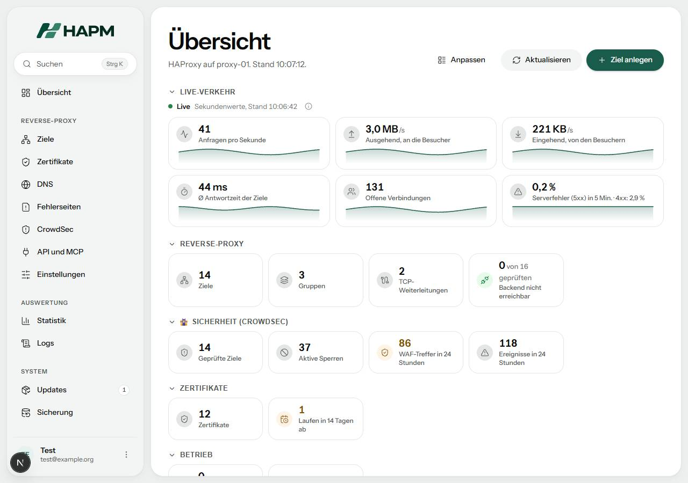
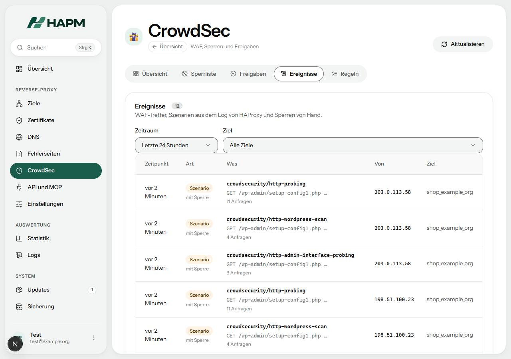
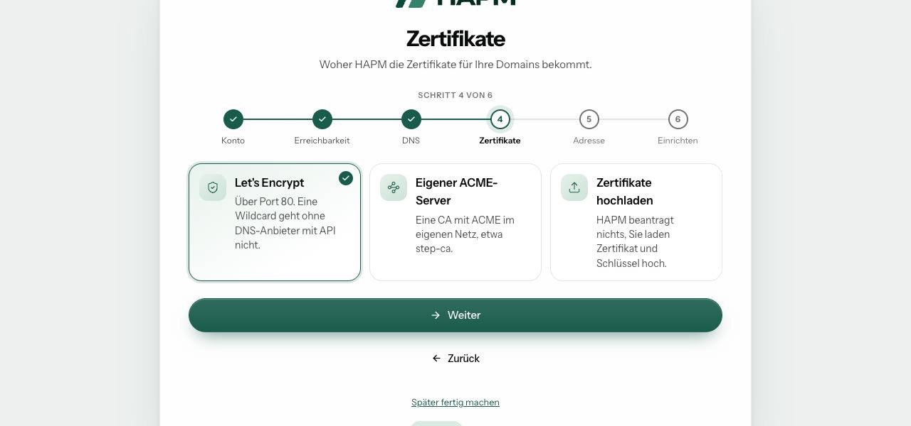
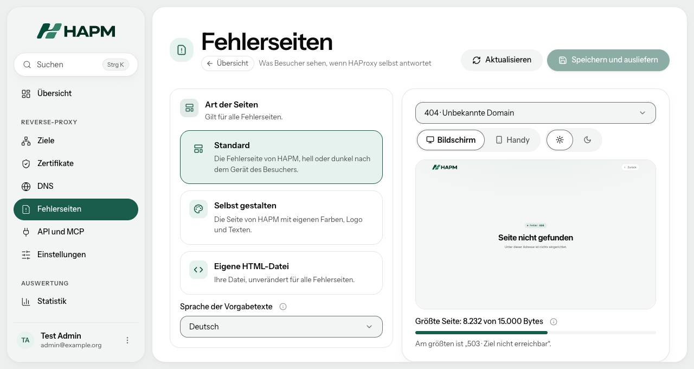
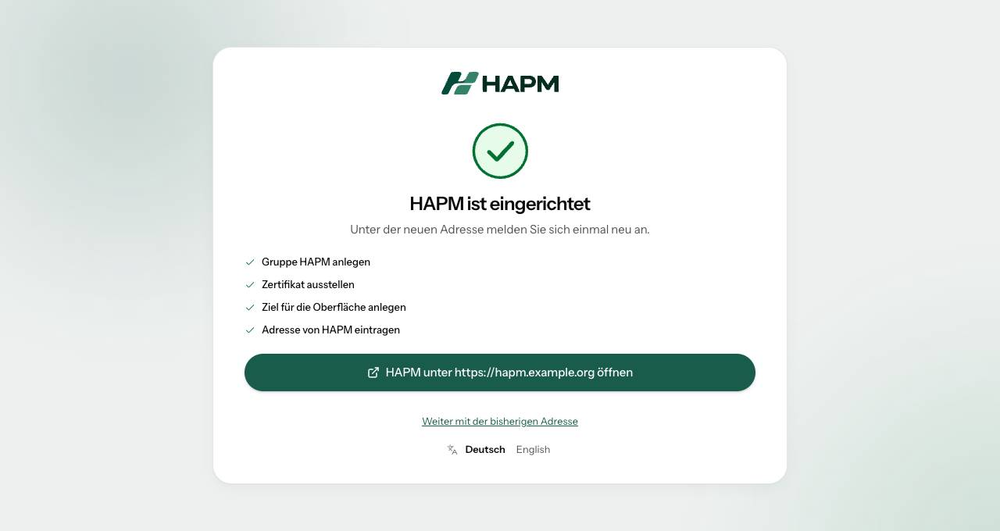
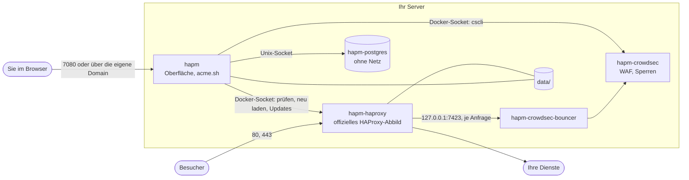

<div align="center">

<picture>
  <source media="(prefers-color-scheme: dark)" srcset="public/hapm-logo-white.svg">
  
</picture>

### HAProxy mit Weboberfläche. Ein Server, ein Befehl, fertig.

Domains, Zertifikate und Weiterleitungen im Browser anlegen.<br>
HAProxy, Let's Encrypt, die Grundkonfiguration und CrowdSec als WAF richtet HAPM selbst ein.

[](https://github.com/tjorvenhu/HAPM/actions/workflows/image.yml)
[](LICENSE)
[](https://github.com/tjorvenhu/HAPM/pkgs/container/hapm)


**Deutsch** · [English](README.en.md)

</div>

---

<p align="center">
  
  
</p>
<p align="center">
  
  
</p>

## Inhalt

- [Was ist HAPM?](#was-ist-hapm)
- [Funktionen](#funktionen)
- [Schnellstart](#schnellstart)
- [Installation](#installation)
  - [Voraussetzungen](#voraussetzungen)
  - [Arbeitsspeicher und Speicherplatz](#arbeitsspeicher-und-speicherplatz)
  - [Weg 1: Nur mit Docker Compose](#weg-1-nur-mit-docker-compose)
  - [Weg 2: Mit dem Installationsskript](#weg-2-mit-dem-installationsskript)
  - [Weg 3: Portainer, Dockge und andere Oberflächen](#weg-3-portainer-dockge-und-andere-oberflächen)
  - [Firmennetz: Firewall und Proxy](#firmennetz-firewall-und-proxy)
- [Erste Schritte](#erste-schritte)
- [Einstellungen](#einstellungen)
- [CrowdSec (WAF)](#crowdsec-waf)
- [Mit Claude steuern (MCP)](#mit-claude-steuern-mcp)
- [Aufbau](#aufbau)
- [Betrieb](#betrieb)
- [Sicherheit](#sicherheit)
- [Fehlerbehebung](#fehlerbehebung)
- [Dokumentation](#dokumentation)
- [Mitmachen](#mitmachen)
- [Lizenz](#lizenz)

## Was ist HAPM?

HAPM ist eine Weboberfläche für [HAProxy](https://www.haproxy.org). Es läuft
als kleiner Docker-Stack auf dem Server, der Ihr Reverse-Proxy sein soll. Sie
legen dort im Browser fest, welche Domain wohin zeigt. HAPM schreibt die
Konfiguration, prüft sie mit HAProxy, lädt neu und holt die Zertifikate.

- **Kein Konfigurationswissen nötig.** Ein Assistent führt durch die
  Einrichtung. Am Ende ist HAPM selbst per HTTPS erreichbar.
- **`haproxy.cfg` bleibt die Wahrheit.** HAPM liest die Datei bei jedem Aufruf
  und schreibt nur zwischen seine eigenen Markierungen. Was Sie von Hand daneben
  eintragen, bleibt unangetastet.
- **Sicher geändert.** Jede Änderung prüft HAProxy, bevor sie gilt. Lehnt
  HAProxy sie ab, bleibt die alte Konfiguration aktiv.

## Funktionen

<table>
<tr>
<td width="50%" valign="top">

**Reverse-Proxy**
- Domains auf ein Ziel im Netz, mit Zertifikat
- Lastverteilung auf mehrere Ziele, mit Gewichtung und Sitzungsbindung
- HTTP-Weiterleitungen (301, 302)
- TCP-Weiterleitungen für beliebige Ports, etwa Datenbanken
- Pfad-Regeln: ein Pfad derselben Domain auf einen anderen Port
- Gruppen, etwa „Websites“ und „Intern“
- Backend-Server einmal hinterlegen und in jedem Ziel auswählen
- Import einer bestehenden `haproxy.cfg` mit Vorschau

</td>
<td width="50%" valign="top">

**Zertifikate und DNS**
- Let's Encrypt über acme.sh, automatisch erneuert
- Wildcard-Zertifikate über DNS-01
- Zonen bei Cloudflare und Hetzner anbinden
- DNS-Eintrag zu einem Ziel auf Wunsch gleich mit anlegen
- Im Dialog sehen, worauf eine Domain gerade zeigt
- Server nur im eigenen Netz: jedes Zertifikat über DNS-01
- Eigener ACME-Server, etwa step-ca im eigenen Netz
- Zertifikate hochladen, wenn HAPM nichts beantragen soll
- Eigener DNS-Server: HAPM nennt die Einträge, statt sie anzulegen

</td>
</tr>
<tr>
<td valign="top">

**Schutz und Darstellung**
- WAF mit CrowdSec: für alle Ziele oder einzelne, Angriffe werden mit 403 abgelehnt
- Adressen sperren und freigeben, Ereignisse je Ziel, OWASP-Regeln auf Wunsch
- Adressen, Länder und zu viele Anfragen sperren (Zugriffsschutz)
- Domains nur für bestimmte IP-Adressen freigeben
- Passwortabfrage vor einer Domain, ausgeliefert von HAProxy selbst
- Fehlerseiten: Standard, selbst gestaltet oder eine eigene HTML-Datei
- Konten mit Passwort, zweitem Faktor und Passkeys

</td>
<td valign="top">

**Betrieb**
- Übersicht in Bereichen, die sich sortieren, zuklappen und ausblenden lassen
- Statistik: Anfragen, Statuscodes, Antwortzeiten, Länder, dazu die von CrowdSec
- Historie jedes Vorgangs mit seinen Schritten
- Die Logs von HAProxy und CrowdSec im Browser, mit Suche und Filter
- Updates von HAPM, HAProxy, acme.sh und CrowdSec auf Klick
- Tägliche Sicherung, auf Wunsch verschlüsselt, und Zurückspielen über die Oberfläche
- Mails bei Ausfällen, ablaufenden Zertifikaten und Fehlern
- API mit Token für Skripte und andere Dienste
- MCP-Server: HAPM aus Claude und anderen KI-Clients steuern
- Oberfläche auf Deutsch und Englisch
- Eigenes Logo, Name und Akzentfarbe, um HAPM als eigenes Werkzeug zu zeigen

</td>
</tr>
</table>

## Schnellstart

Auf einem Linux-Server mit Docker, als root:

```bash
mkdir -p /opt/hapm && cd /opt/hapm
curl -fsSLO https://raw.githubusercontent.com/tjorvenhu/HAPM/main/docker-compose.yml
docker compose up -d
```

Dann im Browser `http://<IP-des-Servers>:7080` öffnen. Der Assistent führt
durch den Rest.

> [!TIP]
> Docker fehlt noch? Dann nehmen Sie das [Installationsskript](#weg-2-mit-dem-installationsskript).
> Es installiert Docker gleich mit.

## Installation

### Voraussetzungen

| Was | Warum |
|---|---|
| Ein **Linux**-Server, `amd64` oder `arm64` | HAPM und HAProxy laufen im Netz des Hosts. Das geht nur unter Linux, nicht mit Docker Desktop auf Mac oder Windows |
| **Docker** mit dem **Compose-Plugin** (Compose v2) | `docker compose version` zeigt, ob es da ist. 2.20 oder neuer ist empfohlen |
| Ports **80** und **443** frei | Dort lauscht HAProxy. Für HTTP/3 zusätzlich 443 über UDP |
| Port **7080** erreichbar | Für die Einrichtung. Danach lässt er sich schließen, siehe [Sicherheit](#sicherheit) |
| Für Zertifikate von Let's Encrypt: Port 80 aus dem Internet erreichbar | Let's Encrypt prüft jede Domain über Port 80. Steht der Server nur im eigenen Netz, geht es über DNS-01 |
| Ausgehend HTTPS (TCP 443) | Für Abbilder, Zertifikate, Updates und die Regeln von CrowdSec. Welche Hosts genau: [Firmennetz](#firmennetz-firewall-und-proxy) |
| **1 GB** Arbeitsspeicher ohne CrowdSec, **2 GB** mit | Der Stack selbst braucht rund 250 MB ohne und rund 390 MB mit CrowdSec, siehe [Arbeitsspeicher und Speicherplatz](#arbeitsspeicher-und-speicherplatz) |

### Arbeitsspeicher und Speicherplatz

Gemessen mit `docker stats` an einer Testinstallation im Leerlauf (amd64,
November 2026). Die Werte sind Richtwerte, kein Versprechen: sie hängen von
der Zahl der Verbindungen und vom Verkehr ab.

| Container | Arbeitsspeicher | Ohne CrowdSec | Mit CrowdSec |
|---|---|:---:|:---:|
| HAPM (Oberfläche, Zeitplan) | rund 120 MB | ja | ja |
| HAProxy | rund 95 MB | ja | ja |
| Postgres | rund 35 MB | ja | ja |
| CrowdSec (Erkennung, WAF) | 100 bis 130 MB | | ja |
| CrowdSec-Bouncer | rund 10 MB | | ja |
| **Summe** | | **rund 250 MB** | **rund 390 MB** |

- **Ohne CrowdSec** (`--no-crowdsec` bei der Installation): rund 250 MB. Ein
  Server mit 1 GB reicht, Betriebssystem und Docker eingerechnet.
- **Mit CrowdSec** (die Vorgabe): rund 390 MB, also etwa 140 MB mehr. Ein
  Server mit 2 GB ist die bequeme Größe. Die beiden Container laufen und
  belegen ihren Speicher auch dann, wenn CrowdSec noch kein Ziel prüft. In der
  Oberfläche abgeschaltet („CrowdSec abschalten") stehen sie und belegen
  nichts.
- **Was den Bedarf erhöht:** viele gleichzeitige Verbindungen (HAProxy), viel
  Verkehr und die Sperrliste der Gemeinschaft (CrowdSec), die OWASP-Regeln im
  Modus „Nur melden" oder „Treffer sperren". Während eines Updates oder einer
  Sicherung kommt kurz ein Helfer-Container dazu.
- **Selbst nachmessen:** `docker stats --no-stream` zeigt den Verbrauch jedes
  Containers.

Auf der Platte belegen die Abbilder rund 1,1 GB ohne und rund 1,7 GB mit
CrowdSec. Dazu kommen die Daten in `data/` (Datenbank, Zertifikate, Logs,
Regeln von CrowdSec): frisch installiert rund 100 MB, mit Logs und Statistik
wird es mehr. Vor einem Update liegt das neue Abbild kurz neben dem alten.

### Weg 1: Nur mit Docker Compose

Ohne Skript, mit genau einer Datei. Diese Anleitung passt auf jedes Linux mit
Docker.

**1. Docker installieren**, falls es fehlt. Die Anleitung für Ihre Distribution
steht unter [docs.docker.com/engine/install](https://docs.docker.com/engine/install/).
Auf Debian und Ubuntu geht es auch mit dem offiziellen Skript von Docker:

```bash
curl -fsSL https://get.docker.com | sh
```

**2. Einen Ordner für HAPM anlegen** und hineinwechseln:

```bash
mkdir -p /opt/hapm && cd /opt/hapm
```

**3. Die Datei `docker-compose.yml` holen:**

```bash
curl -fsSLO https://raw.githubusercontent.com/tjorvenhu/HAPM/main/docker-compose.yml
```

<details>
<summary><b>Ohne Download:</b> die Datei zum Einfügen</summary>

Legen Sie mit `nano docker-compose.yml` eine Datei an und fügen Sie das ein.
Die Kommentare der vollständigen Fassung stehen in
[`docker-compose.yml`](docker-compose.yml).

```yaml
name: hapm

services:
  hapm:
    image: ${HAPM_IMAGE:-ghcr.io/tjorvenhu/hapm:latest}
    container_name: hapm
    restart: unless-stopped
    network_mode: host
    environment:
      PORT: ${HAPM_PORT:-7080}
      HOSTNAME: ${HAPM_BIND:-0.0.0.0}
      TZ: ${TZ:-Europe/Berlin}
      HAPM_ACME_SERVER: ${HAPM_ACME_SERVER:-letsencrypt}
      HAPM_CROWDSEC_OFF: ${HAPM_CROWDSEC_OFF:-}
      HAPM_SPOA_PORT: ${HAPM_SPOA_PORT:-7423}
    depends_on:
      postgres:
        condition: service_healthy
    volumes:
      - ${HAPM_STORAGE:-./data}/hapm:/data
      - ${HAPM_STORAGE:-./data}/haproxy:/etc/haproxy
      - ${HAPM_STORAGE:-./data}/run/haproxy:/run/haproxy
      - ${HAPM_STORAGE:-./data}/log:/var/log/haproxy
      - ${HAPM_STORAGE:-./data}/acme:/root/.acme.sh
      - ${HAPM_STORAGE:-./data}/crowdsec:/crowdsec
      - ${HAPM_STORAGE:-./data}/run/postgres:/var/run/postgresql
      - /var/run/docker.sock:/var/run/docker.sock

  postgres:
    image: postgres:17-alpine
    container_name: hapm-postgres
    restart: unless-stopped
    network_mode: none
    command: >-
      postgres -c listen_addresses='' -c shared_buffers=32MB -c max_connections=20
      -c max_worker_processes=4 -c max_parallel_workers=0 -c autovacuum_max_workers=1 -c jit=off
    environment:
      POSTGRES_DB: hapm
      POSTGRES_USER: hapm
      POSTGRES_HOST_AUTH_METHOD: trust
    volumes:
      - ${HAPM_STORAGE:-./data}/postgres:/var/lib/postgresql/data
      - ${HAPM_STORAGE:-./data}/run/postgres:/var/run/postgresql
    healthcheck:
      test: ["CMD-SHELL", "pg_isready -U hapm -d hapm"]
      interval: 5s
      timeout: 5s
      retries: 12
      start_period: 20s

  haproxy:
    image: ${HAPROXY_IMAGE:-haproxy:lts}
    container_name: hapm-haproxy
    restart: unless-stopped
    network_mode: host
    user: root
    command: ["haproxy", "-f", "/etc/haproxy/haproxy.cfg", "-S", "/run/haproxy/master.sock"]
    depends_on:
      hapm:
        condition: service_healthy
    volumes:
      - ${HAPM_STORAGE:-./data}/haproxy:/etc/haproxy:ro
      - ${HAPM_STORAGE:-./data}/run/haproxy:/run/haproxy
    ulimits:
      nofile:
        soft: 65536
        hard: 65536
    logging:
      driver: json-file
      options:
        max-size: "50m"
        max-file: "3"

  crowdsec:
    image: ${CROWDSEC_IMAGE:-crowdsecurity/crowdsec:latest}
    container_name: hapm-crowdsec
    restart: unless-stopped
    profiles: ["${HAPM_CROWDSEC_OFF:+ohne-crowdsec}"]
    environment:
      TZ: ${TZ:-Europe/Berlin}
      COLLECTIONS: crowdsecurity/haproxy crowdsecurity/appsec-virtual-patching crowdsecurity/appsec-generic-rules
    depends_on:
      hapm:
        condition: service_healthy
    volumes:
      - ${HAPM_STORAGE:-./data}/crowdsec/config:/etc/crowdsec
      - ${HAPM_STORAGE:-./data}/crowdsec/data:/var/lib/crowdsec/data
      - ${HAPM_STORAGE:-./data}/crowdsec/secrets:/run/secrets:ro
      - ${HAPM_STORAGE:-./data}/log:/var/log/haproxy:ro
    logging:
      driver: json-file
      options:
        max-size: "20m"
        max-file: "3"

  crowdsec-bouncer:
    image: ${CROWDSEC_BOUNCER_IMAGE:-crowdsecurity/spoa-bouncer:latest}
    container_name: hapm-crowdsec-bouncer
    restart: unless-stopped
    profiles: ["${HAPM_CROWDSEC_OFF:+ohne-crowdsec}"]
    depends_on:
      - crowdsec
    ports:
      - "127.0.0.1:${HAPM_SPOA_PORT:-7423}:7423"
    volumes:
      - ${HAPM_STORAGE:-./data}/crowdsec/bouncer:/etc/crowdsec/bouncers:ro
    logging:
      driver: json-file
      options:
        max-size: "20m"
        max-file: "3"
```

</details>

**4. Optional: Einstellungen in `.env`.** Ohne diese Datei gelten die
Vorgaben. Ein anderer Port der Oberfläche etwa:

```bash
echo "HAPM_PORT=9000" > .env
```

Alle Werte stehen unter [Einstellungen](#einstellungen).

**5. Starten:**

```bash
docker compose up -d
```

Beim ersten Start lädt Docker fünf Abbilder und HAPM richtet HAProxy ein. Das
dauert etwa eine Minute. Ob alles läuft:

```bash
docker compose ps
```

Alle Container sollten `running` zeigen, `hapm` zusätzlich `healthy`. Das sind
fünf, ohne CrowdSec drei.

**6. Im Browser öffnen:** `http://<IP-des-Servers>:7080`. Weiter geht es unter
[Erste Schritte](#erste-schritte).

> [!NOTE]
> Alle Daten liegen danach in `/opt/hapm/data`: Konfiguration, Zertifikate und
> Datenbank. Wer diesen Ordner sichert, hat alles.

### Weg 2: Mit dem Installationsskript

Für einen frischen Debian- oder Ubuntu-Server. Das Skript installiert Docker,
wenn es fehlt, prüft die Ports 80 und 443, holt `docker-compose.yml` und
startet HAPM. Als root:

```bash
curl -fsSL https://raw.githubusercontent.com/tjorvenhu/HAPM/main/install.sh | sh
```

Am Ende nennt es die Adresse der Oberfläche. Ein zweiter Lauf aktualisiert
HAPM, ohne Daten oder Einstellungen anzufassen.

<details>
<summary><b>Optionen des Skripts</b></summary>

| Option | Variable | Vorgabe | Bedeutung |
|---|---|---|---|
| `--dir ORDNER` | `HAPM_DIR` | `/opt/hapm` | Ordner der Installation |
| `--storage ORDNER` | `HAPM_STORAGE` | `<dir>/data` | Ordner der Daten, etwa auf einer eigenen Platte |
| `--port PORT` | `HAPM_PORT` | `7080` | Port der Oberfläche |
| `--image ABBILD` | `HAPM_IMAGE` | `ghcr.io/tjorvenhu/hapm:latest` | Ein anderes Abbild von HAPM |
| `--force` | `HAPM_FORCE=1` | | Auch starten, wenn Port 80 oder 443 belegt ist |
| `--yes` | `HAPM_YES=1` | | Nichts nachfragen, Vorgaben nehmen |
| `--no-crowdsec` | `HAPM_CROWDSEC=0` | | Ohne CrowdSec installieren: weder Abbilder noch Container, siehe [CrowdSec (WAF)](#crowdsec-waf) |
| `--crowdsec` | | | CrowdSec wieder in den Stack nehmen |
| `--uninstall` | | | HAPM wieder entfernen, siehe [Entfernen](#entfernen) |

Beispiel mit Optionen:

```bash
curl -fsSL https://raw.githubusercontent.com/tjorvenhu/HAPM/main/install.sh | sh -s -- --dir /srv/hapm --port 9000
```

Wo die Daten liegen, entscheidet die erste Installation. Ein späterer Lauf
ändert das nicht.

</details>

### Weg 3: Portainer, Dockge und andere Oberflächen

HAPM ist ein gewöhnlicher Compose-Stack. Legen Sie in Ihrer Oberfläche einen
neuen Stack an und fügen Sie den Inhalt von
[`docker-compose.yml`](docker-compose.yml) ein.

> [!IMPORTANT]
> Setzen Sie dabei die Variable `HAPM_STORAGE` auf einen festen Pfad, etwa
> `/opt/hapm/data`. Ohne sie legt die Oberfläche die Daten relativ zu ihrem
> eigenen Arbeitsordner ab, und dort sind sie schwer zu finden und zu sichern.

### Firmennetz: Firewall und Proxy

Lässt die Firewall ausgehend nur Freigegebenes durch, braucht der Server vor
allem HTTPS (TCP 443) zu diesen Hosts:

- **Abbilder:** `ghcr.io`, `pkg-containers.githubusercontent.com`,
  `registry-1.docker.io`, `auth.docker.io`, `production.cloudfront.docker.com`,
  `production.cloudflare.docker.com`
- **Zertifikate:** `acme-v02.api.letsencrypt.org`, bei DNS-01 dazu
  `cloudflare-dns.com` und die API des DNS-Anbieters (`api.cloudflare.com` oder
  `api.hetzner.cloud`)
- **Updates und Länder:** `api.github.com`, `github.com`,
  `codeload.github.com`, `download.db-ip.com`
- **CrowdSec:** `cdn-hub.crowdsec.net`, `hub-data.crowdsec.net`, für die
  Community-Blocklist `api.crowdsec.net` und `blocklists.api.crowdsec.net`

Dazu DNS (53), NTP (123 UDP) und, wenn Mails eingerichtet sind, der
SMTP-Server (587 oder 465). Geben Sie Hosts nach Namen frei, nicht nach
IP-Adressen: dahinter stehen CDNs mit wechselnden Adressen.

Mit einem Proxy braucht die Docker-Engine ihn für die Abbilder, die Container
`hapm` und `crowdsec` brauchen ihn für ihre eigenen Abrufe. HAPM beachtet
`HTTPS_PROXY` nur zusammen mit `NODE_USE_ENV_PROXY=1`. Die vollständige Liste
mit Zweck je Host und die Einrichtung des Proxys stehen in
[`docs/betrieb.md`](docs/betrieb.md#ausgehende-verbindungen-firmennetz-firewall-proxy).

## Erste Schritte

Nach dem Start öffnet `http://<IP-des-Servers>:7080` den Assistenten. Er hat
sieben Schritte:

| Schritt | Was passiert |
|---|---|
| **1. Konto** | Sie legen das erste Konto an, mit dem Sie HAPM verwalten |
| **2. Erreichbarkeit** | Aus dem Internet erreichbar oder nur im eigenen Netz? Davon hängt ab, wie Zertifikate entstehen |
| **3. DNS** | Cloudflare oder Hetzner mit einem API-Token, dann legt HAPM DNS-Einträge selbst an. Oder **eigener DNS-Server**: HAPM nennt Ihnen jeden Eintrag, den Sie selbst setzen |
| **4. Zertifikate** | **Let's Encrypt** (Vorgabe), ein **eigener ACME-Server** mit Directory-URL, etwa step-ca im eigenen Netz, oder **hochladen**: HAPM beantragt nichts, Sie laden Zertifikat und Schlüssel hoch |
| **5. E-Mail** | Das SMTP-Konto, über das HAPM Mails verschickt: für Passkeys, „Passwort vergessen“ und Benachrichtigungen. Lässt sich überspringen und später unter „Benachrichtigungen“ einrichten |
| **6. Adresse der Oberfläche** | Die Domain für HAPM selbst, etwa `hapm.example.org`. HAPM zeigt den nötigen DNS-Eintrag und legt ihn beim Anbieter an, wenn einer verbunden ist |
| **7. Einrichten** | HAPM stellt das Zertifikat aus und trägt sich selbst als Ziel ein. Danach ist die Oberfläche per HTTPS erreichbar |

<p align="center">
  
</p>

Wenn Sie HAPM danach zum ersten Mal unter seiner Adresse öffnen, bietet ein Fenster an, einen Passkey oder den zweiten Faktor einzurichten. Erst dort, weil Ihr Passwortmanager die Anmeldung dann für die richtige Adresse speichert.

Scheitert ein Schritt, bleibt das Konto bestehen. Sie können die Eingaben
ändern und es erneut versuchen, oder später weitermachen: die Übersicht erinnert
daran.

**Danach:** Unter „Ziele“ legen Sie weitere Domains an. Jedes Ziel gehört in
eine Gruppe. Wer den Assistenten übersprungen hat, legt dort zuerst eine Gruppe
an.

> [!TIP]
> Zum Ausprobieren ohne das Kontingent von Let's Encrypt: `HAPM_ACME_SERVER=letsencrypt_test`
> in `.env` setzen. Die Zertifikate sind dann nicht gültig, aber jeder Ablauf
> lässt sich testen.

## Einstellungen

Alle Angaben in `.env` neben `docker-compose.yml` sind freiwillig. Eine Vorlage
mit Erklärungen steht in [`.env.example`](.env.example). Nach einer Änderung:
`docker compose up -d`.

| Variable | Vorgabe | Bedeutung |
|---|---|---|
| `HAPM_PORT` | `7080` | Port der Oberfläche |
| `HAPM_BIND` | `0.0.0.0` | Adresse, auf der die Oberfläche lauscht. Mit `127.0.0.1` ist sie nur noch über ihre Domain erreichbar |
| `HAPM_STORAGE` | `./data` | Ordner aller Daten auf dem Server |
| `TZ` | `Europe/Berlin` | Zeitzone für Anzeigen und geplante Updates |
| `HAPM_ACME_SERVER` | `letsencrypt` | Vorgabe der Zertifizierungsstelle: `letsencrypt`, `letsencrypt_test`, `zerossl` oder die Adresse eines ACME-Verzeichnisses. Ein eigener ACME-Server unter „Allgemein“ geht vor |
| `HAPROXY_IMAGE` | `haproxy:lts` | Abbild von HAProxy. `haproxy:latest` folgt dem neuesten Zweig |
| `HAPM_IMAGE` | `ghcr.io/tjorvenhu/hapm:latest` | Abbild von HAPM |
| `HAPM_CROWDSEC_OFF` | leer | `1`: CrowdSec gehört nicht zum Stack, Compose holt weder Abbilder noch legt es Container an. Siehe [CrowdSec (WAF)](#crowdsec-waf) |
| `HAPM_SPOA_PORT` | `7423` | Port, auf dem HAProxy den Bouncer von CrowdSec erreicht. Nur auf `127.0.0.1` |

Alles andere stellen Sie in der Oberfläche ein, unter „Allgemein“ und
„Reverse-Proxy, Einstellungen“.

## CrowdSec (WAF)

 HAPM bringt [CrowdSec](https://www.crowdsec.net) mit. Es prüft Anfragen, bevor
HAProxy sie an ein Ziel weitergibt, und lehnt Angriffe mit 403 ab: bekannte
Lücken, verdächtige Pfade wie `/.env`, auf Wunsch die OWASP-Regeln. Aus dem Log
von HAProxy erkennt es Adressen, die Seiten durchprobieren, und sperrt sie.

**Nach der Installation prüft CrowdSec nichts.** Die Container laufen mit, aber
erst wenn Sie CrowdSec in der Oberfläche einschalten, gehen Anfragen dorthin:
unter „Reverse-Proxy, CrowdSec“ für alle Ziele, oder im Dialog eines Ziels mit
dem Schalter „CrowdSec (WAF)“. Wer im Assistenten „aus dem Internet erreichbar“
wählt, bekommt das Einschalten für alle Ziele vorgeschlagen.

In der Oberfläche sehen Sie Sperren, Ereignisse je Ziel und eine Statistik. Sie
können Adressen von Hand sperren oder freigeben und Regeln dazuschalten,
etwa für WordPress.

**Voraussetzungen:**

| Was | Warum |
|---|---|
| Die Abbilder `crowdsecurity/crowdsec` und `crowdsecurity/spoa-bouncer` | Docker lädt sie beim ersten Start selbst |
| Ausgehend HTTPS zum Hub von CrowdSec | Die Regeln kommen von `cdn-hub.crowdsec.net` und `hub-data.crowdsec.net`, siehe [Firmennetz](#firmennetz-firewall-und-proxy) |
| Port `127.0.0.1:7423` frei | Dort erreicht HAProxy den Bouncer. Ein anderer Port: `HAPM_SPOA_PORT` |
| Rund 100 MB Arbeitsspeicher zusätzlich | Gemessen im Leerlauf: CrowdSec etwa 75 MB, der Bouncer etwa 10 MB. Mit den OWASP-Regeln mehr |
| HAProxy 2.4 oder neuer | Das Abbild `haproxy:lts` erfüllt das |

> [!NOTE]
> CrowdSec meldet in der Vorgabe die Adressen, die es sperrt, an die Central API
> von CrowdSec (`api.crowdsec.net`) und bekommt dafür die Community-Blocklist.
> Das ist das Verhalten von CrowdSec selbst. Wie man es abschaltet, steht in
> [`docs/crowdsec.md`](docs/crowdsec.md).

### CrowdSec nachrüsten

Wer HAPM vor CrowdSec installiert hat, hat eine `docker-compose.yml` ohne die
beiden Container. Die Oberfläche blendet CrowdSec dann aus. Nachrüsten:

```bash
sh /opt/hapm/install.sh
```

Das Skript holt die neue `docker-compose.yml`, lässt `.env` und alle Daten, wie
sie sind, und startet die Container neu, jetzt mit CrowdSec. Ohne Skript, mit
Weg 1:

```bash
cd /opt/hapm
curl -fsSLO https://raw.githubusercontent.com/tjorvenhu/HAPM/main/docker-compose.yml
docker compose pull && docker compose up -d
```

Danach steht CrowdSec unter „Reverse-Proxy, CrowdSec“ und prüft noch nichts,
bis Sie es einschalten. Mit Portainer oder Dockge (Weg 3): den Inhalt der neuen
`docker-compose.yml` in den Stack übernehmen und neu bereitstellen.

**Ohne CrowdSec installieren:**

```bash
curl -fsSL https://raw.githubusercontent.com/tjorvenhu/HAPM/main/install.sh | sh -s -- --no-crowdsec
```

Das Skript schreibt `HAPM_CROWDSEC_OFF=1` in `.env`. Docker Compose sieht die
beiden Dienste dann gar nicht: es holt ihre Abbilder nicht und startet keine
Container. Bei Weg 1 und 3: `HAPM_CROWDSEC_OFF=1` in `.env` bzw. in den
Variablen des Stacks, bevor Sie zum ersten Mal starten.

**In der Oberfläche abschalten:** „CrowdSec abschalten“ oben auf der Seite
CrowdSec nimmt es aus jedem Ziel, hält beide Container an und blendet CrowdSec
überall aus. Sperren, Freigaben und Regeln bleiben gespeichert. Wieder
einschalten unter System, Allgemein, Reiter „CrowdSec“.

**Später ganz entfernen:** in der Oberfläche abschalten, dann

```bash
cd /opt/hapm
echo "HAPM_CROWDSEC_OFF=1" >> .env
docker compose rm -sf crowdsec crowdsec-bouncer
docker compose up -d
```

Oder `sh install.sh --no-crowdsec`, das erledigt beides. Wieder dazunehmen:
`sh install.sh --crowdsec`, oder die Zeile aus `.env` löschen und
`docker compose up -d`.
Einzelheiten zu Aufbau, Grenzen und Fehlersuche stehen in
[`docs/crowdsec.md`](docs/crowdsec.md).

## Mit Claude steuern (MCP)

HAPM bringt einen MCP-Server mit. Damit lässt es sich aus Claude (Claude Code,
Claude Desktop, claude.ai) und anderen MCP-Clients steuern: Ziele,
TCP-Weiterleitungen und Gruppen lesen, anlegen, ändern und entfernen, dazu
Zertifikate, Systemstatus, Statistik und DNS-Zonen lesen.

1. In HAPM unter **„API und MCP“** einen API-Key anlegen. Es sind dieselben Keys
   wie für die API.
2. Den Client verbinden, für Claude Code etwa:

   ```bash
   claude mcp add --scope user --transport http hapm https://hapm.example.org/api/mcp \
     --header "Authorization: Bearer hapm_…"
   ```

Fertige Konfigurationen für weitere Clients stehen in HAPM auf derselben Seite
zum Kopieren, Einzelheiten in [`docs/mcp.md`](docs/mcp.md).

> [!WARNING]
> Jedes Werkzeug läuft mit allen Rechten des Keys: es kann Ziele entfernen, Updates
> einspielen, HAProxy neu starten und Einstellungen ändern.
> Geben Sie einen Key nur an Clients, denen Sie das zutrauen.

> [!NOTE]
> Claude Desktop und claude.ai verbinden sich aus der Cloud von Anthropic. HAPM
> muss dafür über HTTPS aus dem Internet erreichbar sein. Claude Code verbindet
> sich vom eigenen Rechner aus und reicht im eigenen Netz.

## Aufbau

Drei Container, dazu zwei für CrowdSec, und ein Ordner für die Daten:



| Container | Aufgabe |
|---|---|
| `hapm` | Die Oberfläche. Schreibt `haproxy.cfg`, holt Zertifikate mit acme.sh, sammelt die Statistik |
| `hapm-haproxy` | Das offizielle HAProxy-Abbild. Nimmt den Verkehr auf Port 80 und 443 an |
| `hapm-postgres` | Die Datenbank: Konten, Einstellungen, Historie. Ohne Netz, nur über einen Unix-Socket erreichbar |
| `hapm-crowdsec` | CrowdSec: WAF, liest das Log von HAProxy, führt Sperren und Freigaben. Abschaltbar |
| `hapm-crowdsec-bouncer` | Nimmt die Fragen von HAProxy an und gibt sie an CrowdSec weiter. Von außen nicht erreichbar |

<details>
<summary><b>Was im Ordner <code>data/</code> liegt</b></summary>

| Unterordner | Inhalt |
|---|---|
| `hapm/` | Schlüssel und Geheimnisse von HAPM. Der Schlüssel darin darf sich nie ändern |
| `haproxy/` | `haproxy.cfg`, Zertifikate, Fehlerseiten |
| `acme/` | acme.sh mit Konto und Erneuerungseinträgen |
| `postgres/` | Die Datenbank |
| `log/` | Das Log von HAProxy, Quelle der Statistik |
| `run/` | Sockets von HAProxy und Postgres |
| `crowdsec/` | Konfiguration, Regeln und Datenbank von CrowdSec, die Einstellungen des Bouncers |

</details>

## Betrieb

### Aktualisieren

In der Oberfläche unter **„Updates“**. HAPM meldet neue Abbilder von sich
selbst, von HAProxy und von CrowdSec, dazu ein neues acme.sh. Ein neues
HAProxy prüft vor dem Tausch die vorhandene Konfiguration. Startet es nicht,
läuft das alte weiter.

**Selbsttätig:** Einmal am Tag zu einer festen Uhrzeit spielt HAPM ein, was Sie
dort ankreuzen. Vorgabe ist alles außer HAPM selbst (HAProxy, acme.sh,
CrowdSec und der Bouncer). HAPM lässt sich dazunehmen, ist beim Tausch aber
etwa eine Minute nicht erreichbar.

**Eine ältere Installation bekommt neue Container** (etwa CrowdSec) nicht über
die Updates-Seite: die tauscht nur Abbilder bestehender Container. Dafür das
Installationsskript erneut ausführen, siehe
[CrowdSec nachrüsten](#crowdsec-nachrüsten).

Von Hand:

```bash
cd /opt/hapm
docker compose pull && docker compose up -d
```

### Sichern

Unter **„Sicherung“** einen Ordner auf dem Server einstellen. HAPM sichert dann
täglich oder auf Knopfdruck: Datenbank, Schlüssel, HAProxy mit Zertifikaten und
acme.sh.

**Verschlüsseln:** Auf derselben Seite unter „Verschlüsselung“ einen
Sicherungsschlüssel eintragen. Ab dann verschlüsselt HAPM jedes Archiv mit gpg
(AES-256), die Datei heißt `….tar.gz.gpg`. Das empfiehlt sich immer, wenn der
Ordner auf einem Netzlaufwerk oder einem anderen Server liegt.

> [!WARNING]
> Das Archiv enthält private Schlüssel. Ohne Sicherungsschlüssel ist es nicht
> verschlüsselt: legen Sie es dann nur an einen Ort, auf den außer Ihnen
> niemand zugreift. Mit Sicherungsschlüssel gilt: ohne ihn lässt sich eine
> Sicherung nicht zurückspielen. Er steht in keinem Archiv, bewahren Sie ihn
> getrennt vom Server auf.

### Zurückspielen

**Über die Oberfläche:** Unter „Sicherung“, Karte „Sicherung zurückspielen“.
Ein Archiv auswählen oder hochladen, etwa beim Umzug auf einen neuen Server.
Ein verschlüsseltes Archiv entschlüsselt HAPM mit dem gespeicherten
Sicherungsschlüssel und fragt nach ihm, wenn keiner gespeichert ist oder er
nicht passt. HAPM sichert vorher den aktuellen Stand und stellt ihn wieder her,
wenn ein Schritt scheitert.

<details>
<summary><b>Von Hand</b>, wenn HAPM nicht läuft</summary>

Auf einem Server mit Docker, in einem Ordner mit `docker-compose.yml`, in dem
HAPM noch nicht läuft. Hier `/opt/hapm`, die Sicherung liegt in
`/srv/hapm-backup`:

```bash
cd /opt/hapm

# 1. Archiv auspacken
mkdir /tmp/hapm-restore
tar -xzf /srv/hapm-backup/hapm-backup-JJJJMMTT-HHMMSS.tar.gz -C /tmp/hapm-restore

#    Ein verschlüsseltes Archiv (….tar.gz.gpg) stattdessen erst entschlüsseln:
#    read -rsp 'Sicherungsschlüssel: ' KEY && echo
#    printf '%s\n' "$KEY" | gpg --batch --pinentry-mode loopback --passphrase-fd 0 \
#      -o /tmp/hapm-backup.tar.gz -d /srv/hapm-backup/hapm-backup-JJJJMMTT-HHMMSS.tar.gz.gpg
#    unset KEY
#    tar -xzf /tmp/hapm-backup.tar.gz -C /tmp/hapm-restore && rm /tmp/hapm-backup.tar.gz

# 2. Nur die Datenbank starten und einspielen
docker compose up -d --wait postgres
docker exec -i hapm-postgres psql -U hapm -d hapm -q -v ON_ERROR_STOP=1 < /tmp/hapm-restore/database.sql

# 3. Schlüssel, HAProxy und acme.sh in den Datenordner legen
mkdir -p data/hapm data/haproxy data/acme
cp -a /tmp/hapm-restore/data/. data/hapm/
cp -a /tmp/hapm-restore/haproxy/. data/haproxy/
cp -a /tmp/hapm-restore/.acme.sh/. data/acme/
rm -rf /tmp/hapm-restore

# 4. Starten
docker compose up -d
```

Danach sind Konten, Einstellungen, Ziele und Zertifikate wieder da.

</details>

### Umziehen

Den Datenordner an einen anderen Ort legen:

```bash
cd /opt/hapm
docker compose down
mv data /srv/hapm-data
echo "HAPM_STORAGE=/srv/hapm-data" >> .env
docker compose up -d
```

Auf einen anderen Server geht es am einfachsten über eine Sicherung: dort HAPM
installieren und das Archiv unter „Sicherung“ hochladen.

### Passwort vergessen

Sind die Adresse von HAPM und ein SMTP-Konto eingerichtet, schickt die
Anmeldeseite einen Link per Mail. Ist die Authenticator-App verloren, ersetzt
bei der Anmeldung einer der Wiederherstellungscodes den Code aus der App
(„Wiederherstellungscode verwenden“). Danach unter „Konto“ neue Codes erzeugen
oder den zweiten Faktor neu einrichten. Sind auch die Codes weg, oder gibt es
keine Mail, auf dem Server:

```bash
docker exec -it hapm hapm-admin reset-password admin@example.org
```

Das setzt ein neues Passwort, schaltet den zweiten Faktor des Kontos ab (seine
Wiederherstellungscodes verfallen damit) und entfernt seine Passkeys. Alle Konten zeigt `docker exec -it hapm hapm-admin users`.

### Entfernen

**Mit dem Skript:** zeigt vorher, was es entfernt, und fragt nach. Mit
`--keep-data` bleiben die Daten liegen.

```bash
sh /opt/hapm/install.sh --uninstall
```

**Nur mit Compose:**

```bash
cd /opt/hapm
docker compose down
cd / && rm -rf /opt/hapm   # löscht auch alle Daten und Zertifikate
docker image prune -a      # optional: nicht mehr benutzte Abbilder entfernen
```

Docker selbst und andere Container bleiben in beiden Fällen unberührt.

## Sicherheit

Was Sie wissen sollten, bevor HAPM produktiv läuft:

1. **Port 7080 schließen.** Solange die Oberfläche keine eigene Domain hat,
   spricht sie unverschlüsselt auf Port 7080. Öffnen Sie ihn in der Firewall nur
   für Ihre eigene Adresse. Sobald HAPM über seine Domain erreichbar ist:

   ```bash
   echo "HAPM_BIND=127.0.0.1" >> .env && docker compose up -d
   ```

   Danach ist Port 7080 von außen nicht mehr erreichbar.
2. **Der Docker-Socket ist eingebunden.** Darüber prüft HAPM die Konfiguration,
   liest Logs und spielt Updates ein. Wer sich an HAPM anmelden kann, hat damit
   Zugriff auf den Server. Vergeben Sie Konten entsprechend und schalten Sie den
   zweiten Faktor ein.
3. **Der Datenordner enthält private Schlüssel.** Das Installationsskript legt
   ihn so an, dass nur root ihn lesen kann. Bei Weg 1 und 3 erledigt das ein
   Befehl nach dem ersten Start:

   ```bash
   chmod 700 /opt/hapm/data
   ```
4. **HAPM öffnet keine Firewall.** Eine TCP-Weiterleitung ist von außen erst
   erreichbar, wenn die Firewall des Servers und die Ihres Anbieters den Port
   durchlassen.

Eine Sicherheitslücke gefunden? Bitte nicht als öffentliches Issue melden,
sondern wie in [`SECURITY.md`](SECURITY.md) beschrieben.

## Fehlerbehebung

<details>
<summary><b>Port 80 oder 443 ist belegt</b></summary>

Ein anderer Webserver lauscht schon. Wer es ist:

```bash
ss -tlnp | grep -E ':(80|443)\s'
```

Häufig ist es ein vorinstalliertes Apache oder nginx. Beenden und abschalten,
etwa mit `systemctl disable --now apache2`. Danach `docker compose up -d`.

</details>

<details>
<summary><b>Die Oberfläche öffnet sich nicht</b></summary>

1. Laufen die Container? `docker compose ps`
2. Was sagt HAPM? `docker compose logs --tail 100 hapm`
3. Lässt die Firewall Port 7080 durch? Bei vielen Anbietern gibt es zusätzlich
   eine Firewall in deren Konsole.
4. Haben Sie `HAPM_BIND=127.0.0.1` gesetzt und die Domain geht nicht mehr?
   Dann die Zeile aus `.env` entfernen und `docker compose up -d`. Die
   Oberfläche ist danach wieder auf Port 7080 erreichbar.

</details>

<details>
<summary><b>Ein Zertifikat lässt sich nicht ausstellen</b></summary>

- **Zeigt die Domain auf diesen Server?** Der Dialog eines Ziels zeigt, worauf
  sie auflöst. Ein neuer DNS-Eintrag braucht manchmal einige Minuten.
- **Ist Port 80 aus dem Internet erreichbar?** Let's Encrypt prüft darüber.
  Steht der Server nur im eigenen Netz, gibt es drei Wege: einen DNS-Anbieter
  mit API (Cloudflare, Hetzner), einen eigenen ACME-Server im Netz oder
  hochgeladene Zertifikate. Den DNS-Anbieter tragen Sie unter „Reverse-Proxy,
  Einstellungen“ ein, ACME-Server und Herkunft der Zertifikate unter
  „Allgemein“, hochgeladen wird unter „Zertifikate“.
- **Zu viele Versuche?** Let's Encrypt begrenzt fehlgeschlagene Anträge. Zum
  Testen `HAPM_ACME_SERVER=letsencrypt_test` verwenden.
- Die Schritte jedes Vorgangs mit der genauen Meldung stehen unter „Logs“.

</details>

<details>
<summary><b>Läuft HAPM unter Docker Desktop auf Mac oder Windows?</b></summary>

Nein. HAPM und HAProxy brauchen das Netz des Hosts (`network_mode: host`), und
das gibt es nur unter Linux. Für die Entwicklung gibt es einen eigenen Stack,
der auch unter Docker Desktop läuft, siehe [`CONTRIBUTING.md`](CONTRIBUTING.md).

</details>

<details>
<summary><b>Ich habe schon eine <code>haproxy.cfg</code></b></summary>

Unter „Ziele“, „Konfiguration importieren“ lesen Sie sie ein. Eine Vorschau
zeigt, was übernommen wird. Was sich nicht genau abbilden lässt, steht mit Zeile
und Grund daneben.

</details>

## Dokumentation

Die ausführliche Dokumentation steht in [`docs/`](docs). Sie erklärt zu fast
jeder Entscheidung, warum sie so getroffen wurde.

| Dokument | Inhalt |
|---|---|
| [`docs/betrieb.md`](docs/betrieb.md) | Container, Volumes, Updates, Datenbank, Ersteinrichtung, Sicherung, ausgehende Verbindungen und Proxy |
| [`docs/reverse-proxy.md`](docs/reverse-proxy.md) | Ziele, Gruppen, Zertifikate, Wildcards, Sperren, Fehlerseiten, Statistik, Import |
| [`docs/reverse-proxy-api.md`](docs/reverse-proxy-api.md) | Die API für Skripte und andere Dienste |
| [`docs/mcp.md`](docs/mcp.md) | Der MCP-Server für Claude und andere Clients |
| [`docs/dns.md`](docs/dns.md) | DNS bei Cloudflare und Hetzner |
| [`docs/crowdsec.md`](docs/crowdsec.md) | CrowdSec: Aufbau, Regeln, Freigaben, Grenzen, Fehlersuche |
| [`docs/i18n.md`](docs/i18n.md) | Übersetzungen der Oberfläche |

## Mitmachen

Fehler und Wünsche gerne als [Issue](https://github.com/tjorvenhu/HAPM/issues).
Wie man HAPM lokal entwickelt, testet und das Abbild baut, steht in
[`CONTRIBUTING.md`](CONTRIBUTING.md).

## Lizenz

Copyright (C) 2026 Tjorven Hüther

HAPM ist freie Software unter der [GNU Affero General Public License,
Version 3](LICENSE) (AGPL-3.0). Jeder darf HAPM benutzen, ändern und
weitergeben. Wer eine geänderte Fassung weitergibt oder anderen über ein Netz
zur Benutzung anbietet, muss ihnen den Quelltext dieser Fassung unter derselben
Lizenz zugänglich machen. Eine Gewährleistung gibt es nicht.

<details>
<summary><b>Lizenzen Dritter</b></summary>

- Die mitgelieferte Länder-Tabelle stammt von [DB-IP](https://db-ip.com)
  („IP to Country Lite“, CC BY 4.0). Neue Stände holt HAPM selbst von dort.
- Die Flaggen stammen aus [`flag-icons`](https://github.com/lipis/flag-icons) (MIT).
- Die Zeichen von Hetzner und Cloudflare stammen aus
  [Simple Icons](https://simpleicons.org) (CC0). Die Marken gehören ihren
  Inhabern. HAPM steht mit keinem der beiden in Verbindung.
- HAProxy und CrowdSec sind Marken ihrer Inhaber. Ihre Zeichen stehen in der
  Oberfläche und hier nur, um das jeweilige Programm zu kennzeichnen. HAPM
  steht mit keinem der beiden in Verbindung.

</details>
